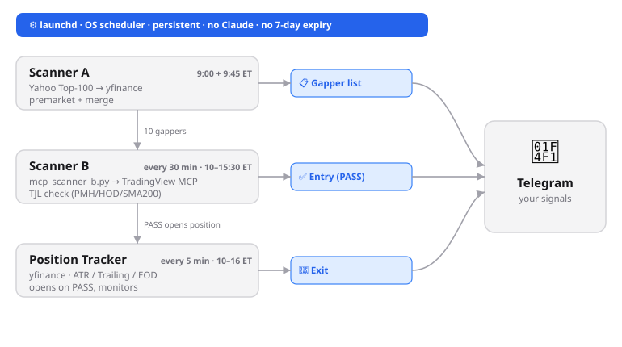

# TradingView Scanner

Automated US stock day-trading scanner with Telegram alerts. Finds premarket gappers, checks technical entry signals (TJL strategy), and monitors exits — all delivered to your phone.



## What it does

1. **Scanner A** (`daily_scanner.sh`) — Scans 5,700+ US stocks for premarket gaps (>5%, >$3, >50K volume), fetches news catalysts
2. **Scanner B** (`tjl_scanner.sh`) — Checks gappers for Trend Join Long entry signals every 30 min during market hours
3. **Position Tracker** (`position_tracker.py`) — Monitors open positions for exit signals (partial profit at +1 ATR, stop at -0.75 ATR, then 0.75 ATR trailing after partial, forced close before EOD)

All alerts are sent via Telegram.

## Documentation

- **[Manual](docs/MANUAL.md)** — full English guide: architecture, strategy, exit rules, schedule, setup

## Requirements

- macOS (uses `launchd` for scheduling)
- Python 3.10+
- Node.js 18+ (for MCP server, optional)
- [TradingView Desktop](https://www.tradingview.com/desktop/) (optional, for live MCP mode)
- A Telegram bot (create via [@BotFather](https://t.me/BotFather))

## Quick Setup

```bash
# 1. Clone
git clone https://github.com/IvanIvMa/TradingView-Scanner.git
cd TradingView-Scanner

# 2. Install Python dependencies
pip3 install -r requirements.txt

# 3. Configure Telegram credentials
cp .env.example .env
# Edit .env with your bot token and chat ID

# 4. Test run
bash daily_scanner.sh
```

## Scheduling (macOS launchd)

Template plist files are in `launchd/`. To install:

```bash
# Replace placeholders with your paths
HOME_DIR="$HOME"
PYTHON_PATH=$(dirname $(which python3))

for f in launchd/*.plist; do
  sed "s|__HOME__|$HOME_DIR|g; s|__PYTHON_PATH__|$PYTHON_PATH|g" "$f" \
    > ~/Library/LaunchAgents/$(basename "$f")
done

# Load all three jobs
launchctl load ~/Library/LaunchAgents/com.tradingview.scanner.plist
launchctl load ~/Library/LaunchAgents/com.tradingview.tjlscanner.plist
launchctl load ~/Library/LaunchAgents/com.tradingview.positiontracker.plist
```

### Schedule (Berlin time)

| Time | Job |
|---|---|
| 15:00 | Scanner A — premarket gappers + news |
| 16:00–20:00 (every 30 min) | Scanner B — TJL entry signals |
| 20:30–22:00 | Position Tracker — exit alerts |

**Important:** Place the project outside `~/Documents`, `~/Desktop`, `~/Downloads` — macOS TCC blocks background processes from accessing those folders.

## Manual runs

```bash
bash daily_scanner.sh              # Scanner A
bash tjl_scanner.sh --force        # Scanner B (skip time gate)
python3 position_tracker.py --force  # Position Tracker (skip time gate)
```

## Project structure

```
.env                    # Telegram credentials (not in git)
daily_scanner.sh        # Scanner A: premarket gappers
tjl_scanner.sh          # Scanner B: TJL entry signals
position_tracker.py     # Exit monitoring (trailing stop, partial profit, EOD)
scanner.py              # Standalone scanner with self-tests
premarket_gappers.sh    # Scanner A early standalone version
telegram_alert.sh       # Telegram helper
enrich_with_benzinga.sh # Premium news via Chrome/Benzinga
fetch_news_chrome.sh    # Chrome scraping docs
ticker_isin.json        # ISIN mapping (auto-updated)
mcp-server/             # TradingView MCP bridge (optional)
launchd/                # macOS scheduling templates
ANLEITUNG.md            # Detailed project documentation (German)
```

## Rules, backtest & cockpit (since 2026-11-16)

- **`tjl_rules.py`** — single source for entry and exit rules. Used by Scanner B, the position tracker, the backtest and the dashboard, so live and backtest run identical logic. Signals always come from Yahoo (TradingView only for charts).
- New filters (above VWAP, relative volume ≥ 2, max 1 ATR above VWAP) and the VWAP-break exit run in **observe mode**: computed, stored and shown, but they do not block signals. Switch with `FILTER_MODE` / `VWAP_EXIT_MODE = "enforce"`.
- **`backtest_exits.py`** — replays the last ~57 days of Scanner A gappers on Yahoo 5-min bars with the same rules → `backtest_results.json`.
- **Cockpit:** `python3 dashboard/app.py` → http://localhost:8050 (health of Scanner A/B, today's signals with filter values, positions, chart with VWAP/entry/stop, performance, backtest).
- `tjl_scanner.sh` pins the Python interpreter (`$PYTHON`, default Python.org 3.14). Homebrew `python3` has no yfinance and silently broke Scanner B from 2026-08-31 to 2026-11-16.

## Data sources

- **Stock data:** Yahoo Finance (free, via yfinance + Screener API)
- **News:** Google News RSS (automatic), Benzinga (premium, via Chrome)
- **Technical data:** Yahoo Finance 1-min bars with premarket flag

## Disclaimer

This is an analysis tool, not trading software. It does not execute trades. Day trading involves substantial risk of loss. Past backtest results do not guarantee future performance. Use at your own risk.

## Documentation

See [ANLEITUNG.md](ANLEITUNG.md) for the full project documentation in German, including strategy details, architecture, backtest results, and lessons learned.
